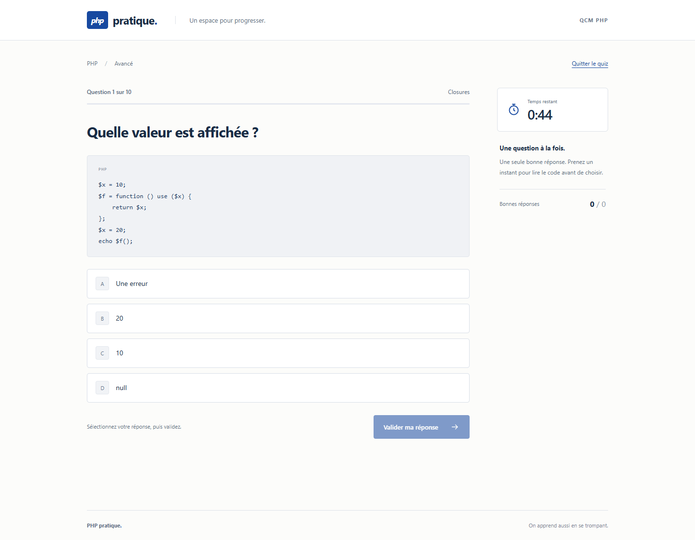

# PHP pratique

Un QCM pour réviser PHP, comprendre ses erreurs et progresser à son rythme. Trois niveaux, des questions chronométrées et une correction expliquée après chaque réponse.

**[Essayer la démo](https://php-pratique-qcm.vercel.app)**

La démo est actuellement une version de prévisualisation protégée par l'authentification Vercel. Un accès autorisé au projet peut être demandé.


## Fonctionnalités

- Choix entre Débutant, Intermédiaire et Avancé.
- 45 questions PHP, dont 15 par niveau ; 10 questions tirées par tentative.
- Questions et choix de réponse mélangés à chaque nouvelle tentative.
- Timer par question, avec alerte rouge durant les dix dernières secondes.
- Réponse verrouillée après validation et correction accompagnée d'une explication.
- Score final sur 10, pourcentage et récapitulatif filtrable sur les erreurs.
- Reprise de la tentative après actualisation, sans réinitialiser le délai.
- Interface responsive, navigation au clavier et respect de la réduction des animations.

| Niveau | Temps par question | Notions abordées |
| --- | --- | --- |
| Débutant | 40 secondes | Syntaxe, variables, conditions, boucles et tableaux |
| Intermédiaire | 45 secondes | Fonctions, objets, formulaires et sessions |
| Avancé | 60 secondes | Typage, PHP 8, comportement du langage et sécurité |

Une bonne réponse vaut un point. Une erreur ou un délai dépassé vaut zéro, sans pénalité supplémentaire. Le timer s'arrête pendant la lecture de la correction.



## Architecture

```text
React / Vite
    |
    | /api : question, choix, correction, résultat
    v
API Express dans une Vercel Function
    |
    | Firebase Admin SDK
    v
Cloud Firestore
```

Le navigateur affiche la question actuelle et envoie l'identifiant du choix sélectionné. Le serveur vérifie la tentative, le délai et la réponse, puis enregistre le résultat dans une transaction Firestore. Le bon choix et son explication sont transmis après validation.

La correction compare le choix avec la réponse enregistrée dans la banque. Les exemples de code PHP sont affichés comme du texte ; ils ne sont pas exécutés.

En développement, Vite monte la même API sur `/api`. Il n'y a ni processus serveur séparé à lancer ni base SQLite.

## Installation locale

**Prérequis :** Node.js 22.13 ou plus récent, npm et un projet Firebase avec une base Firestore Standard `(default)`. Node.js 24 LTS est recommandé.

```sh
git clone https://github.com/Gitzak/quiz-app-with-timer-2.git
cd quiz-app-with-timer-2
npm ci
```

### 1. Configurer Firebase

Créer un compte de service dédié avec le rôle IAM **Cloud Datastore User**. Conserver son fichier JSON privé hors du dépôt.

Copier `.env.example` vers `.env`, puis adapter les valeurs :

```dotenv
FIREBASE_PROJECT_ID=votre-projet-firebase
GOOGLE_APPLICATION_CREDENTIALS=/chemin/absolu/hors-du-depot/firebase-admin.json
```

Sous Windows, un chemin comme `C:/Users/votre-nom/.config/php-pratique/firebase-admin.json` convient aussi. Les scripts locaux chargent `.env` s'il existe. Aucune variable `VITE_` n'est nécessaire.

Publier les règles de [firestore.rules](firestore.rules) dans Firebase. Elles refusent tout accès direct depuis les clients ; l'API accède à Firestore avec les autorisations IAM de son compte de service.

### 2. Importer les questions

```sh
npm run firebase:seed
```

Le script importe les questions de [scripts/questions.js](scripts/questions.js) dans trois documents de `quiz_banks`. Les niveaux déjà présents sont conservés. Pour les remplacer explicitement :

```sh
npm run firebase:seed -- --overwrite
```

Cet import ne supprime pas les tentatives existantes. Il ne s'exécute pas à chaque démarrage ou déploiement.

### 3. Démarrer

```sh
npm run dev
```

Ouvrir l'adresse affichée par Vite, habituellement `http://127.0.0.1:5173`. Le frontend et l'API utilisent le même port.

## Commandes

| Commande | Utilisation |
| --- | --- |
| `npm run dev` | Lancer l'interface et l'API locale connectée à Firestore |
| `npm run build` | Générer le frontend dans `dist/` |
| `npm run preview` | Prévisualiser le dernier build avec l'API locale |
| `npm run lint` | Vérifier le code avec ESLint |
| `npm run check` | Exécuter lint et build |
| `npm run firebase:seed` | Importer les niveaux manquants dans Firestore |
| `npm audit` | Vérifier les avis de sécurité des dépendances |

Exécuter `npm run build` avant `npm run preview`. La prévisualisation nécessite les mêmes identifiants Firebase que le développement. Les vérifications locales dans `tests/` sont exclues de Git et du déploiement.

## Déploiement sur Vercel

Importer le dépôt dans Vercel et sélectionner Node.js 24. [vercel.json](vercel.json) configure le preset Vite, la commande de build, `dist/`, les en-têtes HTTP et les routes `/api/*` vers `api/index.js`.

Dans **Settings > Environment Variables**, définir :

| Variable | Valeur | Visibilité |
| --- | --- | --- |
| `FIREBASE_PROJECT_ID` | Identifiant du projet Firebase | Configuration serveur |
| `FIREBASE_SERVICE_ACCOUNT_JSON` | Contenu complet du JSON du compte de service | Variable sensible |

Sélectionner les environnements concernés, par exemple Preview et Production, puis déployer. Après une modification des variables, redéployer pour les appliquer.

Le chemin local `GOOGLE_APPLICATION_CREDENTIALS` ne doit pas être utilisé sur Vercel. Aucun fichier JSON privé n'est livré avec le code. Aucune commande `npm start` ni aucun disque persistant ne sont nécessaires.

## Stockage et sécurité

| Collection Firestore | Contenu |
| --- | --- |
| `quiz_banks` | Questions, réponses correctes et explications, par niveau |
| `quiz_attempts` | Progression, échéances et réponses de chaque tentative |
| `quiz_rate_limits` | Compteurs de requêtes partagés entre instances |

- Le score et les délais sont contrôlés par le serveur, indépendamment des valeurs affichées dans React.
- Les transactions verrouillent les réponses et empêchent les doubles soumissions de compter deux fois.
- Une tentative est identifiée par un jeton aléatoire de 256 bits, placé dans un cookie HttpOnly et SameSite=Strict, avec Secure sur Vercel. Seule son empreinte est conservée en base.
- Les tentatives expirent après deux heures d'inactivité. Les documents expirés sont refusés immédiatement et nettoyés par petits lots aux nouvelles tentatives.
- Les mutations exigent du JSON, un en-tête personnalisé et une origine cohérente. Les requêtes sont limitées et les réponses API ne sont pas mises en cache.
- `.env`, les identifiants locaux et les fichiers de vérification sont exclus de Git et du déploiement. Ne jamais exposer un identifiant Admin dans une variable `VITE_`.

Un fichier JSON de compte de service donne accès aux données autorisées par IAM. S'il est divulgué, révoquer la clé dans Google Cloud et remplacer les identifiants locaux et Vercel.

**Limites :** un utilisateur peut mémoriser les corrections après validation ou modifier visuellement sa page. La banque d'exemple dans `scripts/questions.js` est lisible par toute personne ayant accès au dépôt ; une banque confidentielle doit être importée sans être publiée dans les sources. Ce projet est un outil d'apprentissage, pas un système de surveillance d'examen.

Les compteurs et les tentatives consomment des lectures et écritures Firestore. Surveiller les quotas dans Firebase > Usage.

## Organisation du projet

```text
api/index.js                 Entrée de la Function Vercel
server/app.js                Routes HTTP et contrôles des requêtes
server/engine.js             Déroulement du quiz, correction et score
server/firestore-store.js    Persistance et transactions
server/question-repository.js Lecture et validation des questions
server/firebase.js           Connexion Firebase Admin
scripts/questions.js         Banque initiale pour l'import
scripts/seed-firestore.mjs    Import des questions
src/                         Interface React et styles
docs/images/                 Captures de l'application
firestore.rules              Règles d'accès direct à la base
vercel.json                  Configuration du déploiement
```
